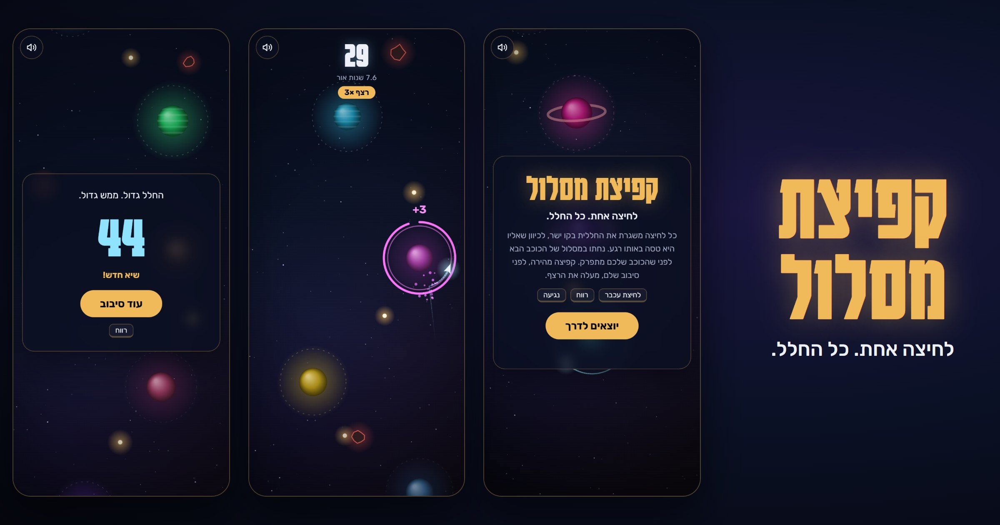

# 🪐 קפיצת מסלול

**משחק לחיצה אחת בחלל | קובץ HTML אחד | עובד גם בלי אינטרנט**

> החללית מקיפה כוכב. לחיצה - והיא נורית בקו ישר. 
> תנחתו בכוכב הבא לפני שהכוכב שלכם מתפרק.

**[▶ לשחק עכשיו](https://beniabot.github.io/orbit-hop/)** · **[⬇ להורדה, לשחק בלי אינטרנט](https://github.com/BeniaBot/orbit-hop/releases/latest)**

---

### 🎮 איך משחקים

* **לחיצה, רווח או נגיעה** - משגרים לכיוון שאליו החללית טסה באותו רגע
* **קפיצה לפני סיבוב שלם** - מעלה את הרצף, עד שש נקודות לכוכב
* **כדורי זהב** - עוד שתי נקודות
* **סלעים אדומים** - לא
* **M** - השתקה

### 🤖 איך זה נוצר

הנחיה אחת לקלוד אופוס 5.5 (Claude Opus 5.5): **"תפתיע אותי"**. 
בלי רעיון מוכתב, בלי הכוונה ובלי אף תיקון של אדם. הרעיון, הקוד, העיצוב, הצלילים והטקסטים - שלו.

---

> ⚠️ **אזהרת ממכר:** הכפתור בסוף כתוב "עוד סיבוב", בלשון יחיד. אל תאמינו לו.

רישיון MIT · גופנים: Rubik ו-Karantina (רישיון SIL OFL)

English

**Orbit Hop** - a one-button space game in a single HTML file (Hebrew interface).
Your ship circles a planet. Tap to fire it in a straight line, and land on the next planet before yours collapses. Hop before a full lap to build a combo.

Made from a single prompt to Claude Opus 5.5 - "surprise me" - with no human direction or corrections.

[Play](https://beniabot.github.io/orbit-hop/) · [Download for offline play](https://github.com/BeniaBot/orbit-hop/releases/latest) · MIT license

